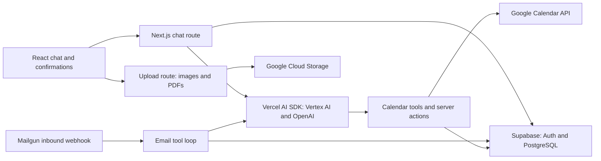

# cal.ad

A discontinued calendar assistant that turned chat messages, forwarded emails, images, and PDFs into Google Calendar actions.

**Status:** developed February–July 2025; discontinued and closed to new sign-ups. This repository preserves the implementation for study and portfolio reference. The hosted product is not offered as an active service. Later maintenance commits include dependency security fixes and the closure of registration and purchasing. The closure behavior remains in this source.

## What it did

- **Chat scheduling:** streamed AI responses with structured calendar tools. Event creation, modification, and deletion used interactive confirmation components; calendar listing and search supplied context to the assistant.
- **Email scheduling:** a Mailgun inbound webhook verified signatures, checked registered senders and usage limits, processed message attachments, and ran a tool loop that could act on calendars and send replies. Email actions could execute directly, unlike chat confirmation dialogs.
- **Document input:** chat uploads accepted images and PDFs, stored attachments in Google Cloud Storage, and returned signed URLs for model input. The upload route enforced 10 MB and 15 PDF pages. Email supported images, PDFs, and plain text. Extraction depended on model interpretation, rather than a separate deterministic parser.
- **Calendar details:** timed and all-day events, recurrence rules, time zones, reminders, attendees, and optional Google Meet links. Subscription checks separated event creation from advanced search/list/edit/delete tools.
- **Tool-call repair:** invalid tool arguments were inspected against Zod schemas, then individual fields (including IANA time zones) were repaired with OpenAI structured outputs. This was a recovery mechanism, not a correctness guarantee.

## Architecture



Next.js 15 App Router and React 19 provide the UI and server endpoints. Styling uses Tailwind CSS and HeroUI. Supabase stores conversations, account settings, calendar selections, OAuth session records, subscriptions, and email usage. Google OAuth supplied Calendar access; refresh-token encryption uses `APP_SECRET`. Historical billing used Lemon Squeezy, rate limiting used Redis/Upstash, and analytics used PostHog.

The chat route selects Gemini models through Vertex AI; email selects Vertex AI or OpenAI according to entitlement. OpenAI also handles tool repair. Model names are preserved from the implementation and may no longer be available.

| Source | Responsibility |
| --- | --- |
| `app/api/chat/route.ts` | Authenticated streaming chat, calendar tool schemas, conversation persistence |
| `app/api/webhooks/mailgun/route.ts` | Inbound email processing and AI tool execution |
| `components/chat/`, `components/calendar/` | Chat UI and editable event confirmations |
| `actions/calendar/`, `utils/calendar/` | Calendar CRUD, search, token refresh, recurrence handling |
| `utils/repairToolCall.ts` | Schema-driven tool argument repair |
| `app/api/upload/route.ts`, `utils/storage.ts` | Attachment validation and signed storage URLs |
| `supabase/migrations/` | Database schema, functions, triggers, and row-level policies |
| `utils/site-closure.ts`, `middleware.ts` | Closed registration and purchase entry points |

## Local study and configuration

This is an archived application snapshot, **not a turnkey self-hosting distribution**. Registration, OAuth callbacks, onboarding, and purchases have intentionally been closed. Running it locally does not restore the former service or create a usable signed-in account. Reviving a personal fork would require separate authentication, security, provider, and database work.

Use a current Node.js installation supported by the locked Next.js version and npm. Start from an isolated checkout with your own disposable resources:

```bash
npm ci
cp .env.example .env.local
# Fill only the variables needed for the code paths you are studying.
npm run dev
```

Open `http://localhost:3000` to inspect the closure page. Never copy the former operator's environment, service-account keys, database, or calendar entries. `npm start` runs a previously built application; it does not build one.

```bash
npx tsc --noEmit
npm run build
```

There is no committed automated test suite or GitHub Actions workflow. The old `test:webhook` command referenced a missing script and has been removed. Type checking and production building do not validate live integrations.

### Environment variables

`.env.example` contains placeholders only. Keep secrets in ignored `.env.local`; variables prefixed `NEXT_PUBLIC_` are browser-visible.

| Area | Variables read by the implementation |
| --- | --- |
| App and database | `NEXT_PUBLIC_APP_URL`, `NEXT_PUBLIC_SUPABASE_URL`, `NEXT_PUBLIC_SUPABASE_ANON_KEY`, `SUPABASE_SERVICE_ROLE_KEY` |
| Google OAuth and token encryption | `GOOGLE_CLIENT_ID`, `GOOGLE_CLIENT_SECRET`, `APP_SECRET` |
| Vertex AI and attachment storage | `GCP_PROJECT_ID`, `GCP_CLIENT_EMAIL`, `GCP_PRIVATE_KEY`, `GCS_BUCKET_NAME` |
| OpenAI | `OPENAI_API_KEY` |
| Optional AI gateway | `CLOUDFLARE_GATEWAY`, `CLOUDFLARE_ACCOUNT_ID`, `CLOUDFLARE_GATEWAY_ID` |
| Email | `MAILGUN_API_KEY`, `MAILGUN_DOMAIN`, `MAILGUN_EMAIL`, `MAILGUN_WEBHOOK_SIGNING_KEY` |
| Redis rate limits | `KV_REST_API_URL`, `KV_REST_API_TOKEN`; URL fallbacks: `REDIS_URL`, `KV_URL` |
| Contact-form captcha | `TURNSTILE_SECRET_KEY`, `NEXT_PUBLIC_TURNSTILE_SITE_KEY` |
| Historical billing | `LEMON_SQUEEZY_SIGNING_SECRET`, `LEMON_SQUEEZY_PRODUCT_ID`, `LEMON_SQUEEZY_VARIANT_ID`, `LEMON_SQUEEZY_STORE_ID`, `LEMON_SQUEEZY_API_KEY`, `NEXT_PUBLIC_LS_PLUS_BUY_LINK`, `NEXT_PUBLIC_LS_CUSTOMER_PORTAL_LINK` |
| Analytics | `NEXT_PUBLIC_POSTHOG_KEY`, `NEXT_PUBLIC_POSTHOG_HOST` |

`VERCEL_URL`, `VERCEL_ENV`, and `VERCEL_PROJECT_PRODUCTION_URL` are platform-provided metadata used by the app or retained starter instructions. `VERTEX_LOCATION`, `GOOGLE_APPLICATION_CREDENTIALS`, and `KV_REST_API_READ_ONLY_TOKEN` appear in older configuration examples/types but are not read by application code. Vertex locations are selected in `utils/ai-config.ts`.

Supabase's checked-in local configuration is historical: its seed file is absent and the migration requires extensions including `plv8` and `pgsodium`. Database startup/migration portability has not been established. Google provider configuration and API consent would also be needed for a revived fork. No production database migration, webhook delivery, OAuth exchange, or calendar operation is required to read this code.

## Limitations and privacy

- AI-generated dates, recurrence, attendees, and edits require review. Model/provider versions and external APIs may have changed.
- Closure changes intentionally prevent the former onboarding and purchase flows. Legacy billing and marketing files are historical implementation material.
- Original code contains verbose operational logging, including message/tool arguments and calendar information. A revived fork needs a logging/privacy review before handling real data.
- Calendar actions and inbound email can have real side effects. Use synthetic identities and calendars for any future testing.
- The locked dependencies have known security advisories; this snapshot is for study. See the release review for counts and validation limits.
- No fabricated product screenshots or live-account recordings are included. The architecture above describes source behavior, not a simulated running service.

## License and provenance

Original project contributions are MIT-licensed **with an explicit exception for HeroUI Pro (v2) components and derived portions**; see [LICENSE](LICENSE). Pro material retains the [HeroUI Pro v2 terms](https://v2.heroui.pro/license). The [v2 FAQ](https://v2.heroui.pro/pricing) permits use in open-source applications subject to its restrictions on repackaging components. The release is prepared as a calendar application, not as a component collection. The repository has mixed license terms and must not be described as entirely MIT-licensed. See [THIRD_PARTY_NOTICES.md](THIRD_PARTY_NOTICES.md) for the UI provenance inventory and other third-party notices.

**Release preparation is incomplete:** token revocation, custom asset rights, and the final UI provenance mapping must be resolved before this private repository or a reviewed clean-history copy is published. See [the release review](docs/OPEN_SOURCE_REVIEW.md).
